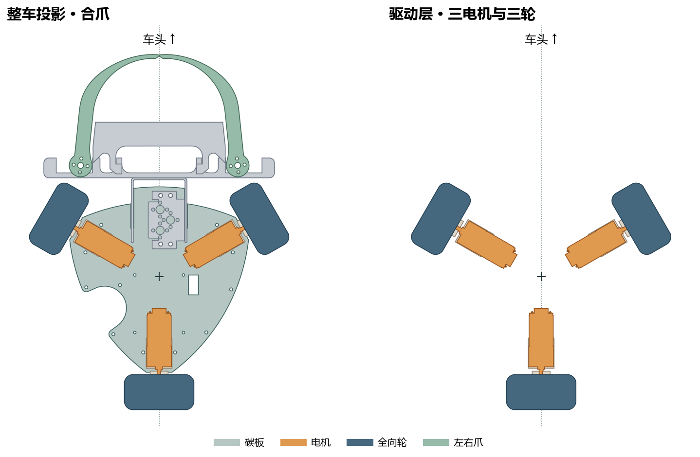

# Motion Sim Bridge

**只查一个点位**请直接打开 [pose_check.html](pose_check.html)。点地图或输入 X、Y（毫米）和车头朝向（度），可见目标姿态、放大投影和相交部件。点击“点选起点”可附加检查同一朝向的直线平移段。页面自带独立测试台，可离线使用。



在已有本机地图上使用时，只需生成一次页面。之后可以反复点选，或给同事一个带参数的本机链接。

```bash
python pose_check.py --map local/field-map.json --out local/point_check.html
node check_pose.cjs local/point_check.html 100 -80 90
```

最后三个数依次为目标 X_mm、Y_mm、航向度；可在后面追加起点 X_mm、Y_mm。Node 命令和网页用同一套几何内核，返回目标姿态、直达段、接触部件和查看链接。几何姿态为水平底盘、合爪、前端零位。二维显示来自 STEP，固定物判定由碰撞模型的各凸件按障碍高度裁剪，固定航向的平移采用连续分离轴检查。不可动物按其地图多边形和高度区间处理，坡边取保守外包络。可动物体或减速带相交时单列复核。几何可放仅说明名义尺寸下能摆下，定位误差、转向及绕行另行验证。

已有 Canvas 页面可以用 `pose_geometry.js` 的 `VehiclePose.draw(ctx, plan, {x_mm,y_mm,heading_mdeg}, worldToPixel)`；plan 直接读 `assets/vehicle_plan.json`，worldToPixel 接收场地毫米并返回屏幕像素。轮廓已带碳板缺口、电机、支架、轮组和前端，无需重画。

这是供运动规划、嵌入式控制和回放验证共用的几何基线。车体坐标以三轮轴线在水平面上的交点为原点，原点高度在地面，+X 朝前，+Y 朝左，+Z 朝上。STEP 和二维轮廓使用毫米，MuJoCo 模型使用米。轨迹使用米、秒和角度，航向从地图 +X 朝 +Y 逆时针为正。

- `assets/vehicle.step` 为可单独打开的装配。三只全向轮以旋转外廓替代细滚子，顶部定位器用外包络表示，左右爪、舵机支架、前推板和底盘保留 CAD 几何。
- `assets/profiles.json` 可直接给路径规划器读取。含两爪和底盘的外环、孔洞、上下表面高度和爪轴线。轮廓圆弧和样条采样弦差设为 0.04 mm，左右爪各保留五孔。爪角以装配姿态为零，绕 +Z 的数学角为正，左右轴分别输入。这个零位需通过机械标定换算为舵机指令。
- `HANDOFF.md` 提供两端接入说明。记录资产版本请使用本仓库提交 SHA。运行场景由操作者在本机单独提供。

几何用于近地碰撞与路线预检。轮子外廓覆盖滚子的旋转空间，滚子滚动、侧滑、载荷变形和真实制动距离应通过实测日志校准。

## 运行与复测

使用 Python 3.11。圆柱测试台和回归用例均可在本机独立运行。

```bash
python -m pip install -r requirements.txt
python demo.py
python test_replay.py
```

把自有环境和采样记录放在本机的 `local/` 目录。以 `assets/vehicle.xml` 为场景底稿，在 worldbody 添加几何。固定障碍推荐使用 contype=1、conaffinity=6，自由物体使用顶层 body、freejoint、contype=4、conaffinity=7。底盘和两爪按轨迹驱动。接触检查支持平面、基本凸形状和凸网格；凹形部件应分解为多个凸体。

```bash
python replay.py local/scene.xml local/trace.jsonl --dynamics --record local/states.npz --out local/report.json --fail-on-block
python play.py local/scene.xml local/states.npz
python compare.py local/scene.xml local/command.jsonl local/feedback.jsonl --command-rev REV_A --controller-rev REV_B --out local/comparison.json
```

**轨迹。** 每行必填 `t_s, x_m, y_m, yaw_deg, left_deg, right_deg`。航向连续展开，时间严格递增。可额外填写 `z_m, roll_deg, pitch_deg` 中任意字段，整条轨迹保持相同字段。高度为车体参考点相对名义地面的位移。姿态采用 Z-Y-X 顺序和右手正方向，省略的高度、横滚和俯仰取零。可再填 `front_deg` 描述前端机构相对底盘的俯仰。其零位由 CAD 装配定义，绕车体 +Y 转动，正值使爪尖下行。前推板、支架和两爪随动，两爪还可绕各自轴独立开合。舵机脉宽至实际铰角需要按实车标定。`--keyframe NAME` 可加载场景中自由物体的初始位姿与速度。

**受阻。** 程序用表面运动距离和凸体间距检查两个输入样本之间的扫掠。遇到可能碰撞的区间就递归二分。无法在细分精度内确认可通过时，舍弃该次尝试并返回 `blocked`。报告分别保存已接受末态 `final_pose`、受阻部件、检查间隙及尝试位姿。起点已有明显重叠时返回 `initial_overlap`，已接受末态为空。`--fail-on-block` 令受阻运行返回退出码 2。接近相切时可能提前微量停车。轮毂、滚子和安装孔采用碰撞近似。两爪相互检查，也检查车体外部部件；爪与舵机安装座、转臂与配合铰座之间的配合部件豁免自碰检查。

**推物。** `--dynamics` 开启自由物体响应，采用不大于 1 ms 的基础时间步。每个候选步计算接触解并修正自由物体位置，随后检查扫掠与末态再决定接受或回退。刚性固定障碍的数值容差为 0.0002 mm。动态可动物体接触及轮地支撑容许最多 0.4 mm 微量嵌入，薄件按厚度进一步收紧。报告的 `max_accepted_penetration_mm` 是已保存状态的活动接触最大实测穿入量。质量、摩擦、轮地侧滑和控制器响应仍需实测标定。

**查看和对照。** 录像保存约 60 Hz 的已接受广义坐标和最终状态，包含自由物体及两爪。查看器在末态停留，关闭窗口退出。`play.py --check` 可无窗口校验记录与场景。对照工具分别回放两条轨迹，在共同时间区间按相同时间插值计算位置、航向和爪角偏差。应使用同一坐标原点与时钟；时钟偏移需要在输入端校准。输出携带轨迹和顶层场景 SHA-256、引擎版本及调用方提供的两个代码版本。外部引用的网格和配置由调用方随场景一同锁定。

## 双图地图

单独打开 `map_view.html`，选择本机地图即可并排查看实物平面和二维控制坐标。两图同步缩放、平移、选物与读数，左图显示区域和物件，右图显示毫米网格、参考点及航向。可载入两端各自的 JSON 或逐行 JSON 轨迹；多帧使用同一时钟的 `t_s`。上位位姿字段为 `x_m, y_m, yaw_deg`；下位反馈字段为 `x_mm, y_mm, heading_mdeg`。选定时刻显示各轨迹最近一次已采样的位姿。孤立快照可省时间。

```bash
python field_map.py build local/field-map.json local
python field_map.py upper path/to/map_app.py local/field-map.json -- --demo
```

第一条命令生成自带本机地图的 `viewer.html` 和 C11 头文件 `field_map.h`。第二条使用现有 OpenCV 地图程序的 `world_to_pixel` 投影，仅替换底图绘制。两端共读同一份几何。C 表使用毫米顶点、微米高度，调用 `fm_contains_xy` 查询含边界的点。车体姿态、几何扫掠和动态接触由回放程序处理。

输入地图为 `schema=field-map-v1`、`frame=field`、`units=m` 的 JSON。`bounds_m` 依次为最小 X、最小 Y、最大 X、最大 Y；`features` 每项包含唯一 id、几何类别 layer、显示名称 label、十六进制 color、顶点序列 xy_m 和高度区间 z_m。可用 labels 提供 x_m/y_m/text，用 starts 提供 id、upper_m、lower_m、yaw_deg。生成物、运行日志和环境数据留在本机。
